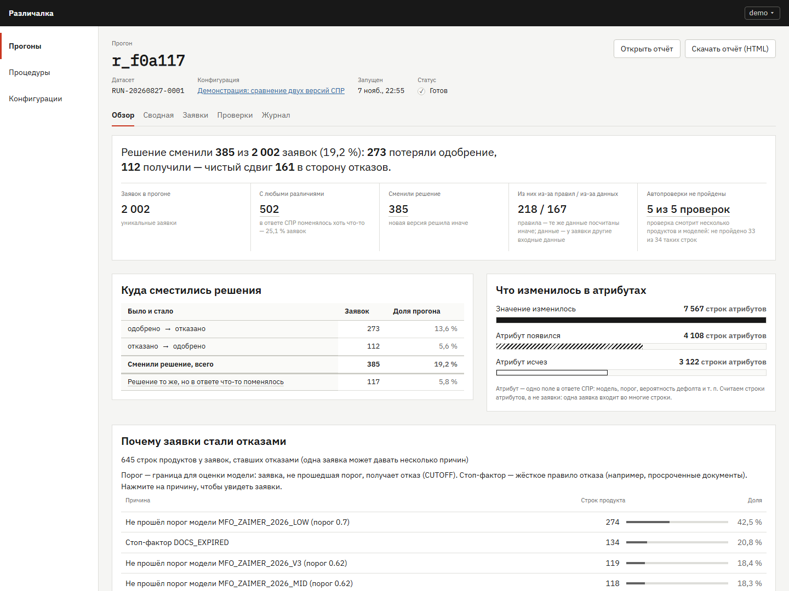

# Различалка

Сравнивает решения двух версий системы принятия решений: какие заявки поменяли решение, кого это затронуло и почему.

Хакатон Nuclear IT Hack, НИЯУ МИФИ, 6–8 ноября 2026. Задача от Баланс-Платформы: «Система анализа изменений».

Что умеет: приводит ответы двух версий СПР к плоским атрибутам, находит различия по каждой заявке, считает, у скольких сменилось решение и из-за чего (логика или входные данные), строит сводную таблицу, запускает проверки PASS/FAIL (в том числе написанные прямо в приложении) и выгружает HTML-отчёт.



## Как запустить

Нужен Docker. Датасет и проверки организаторов в Git не лежат и в образ не попадают: подключаются томами только на чтение.

### Запуск с нуля

```bash
cp .env.example .env
docker compose up -d --build
curl localhost:8000/api/health
```

В `.env` поправь, если нужно:

| Переменная | По умолчанию | Что это |
|---|---|---|
| `DATASETS_PATH` | `./ПАКЕТ/ЗАДАНИЕ/data` | папка с датасетом (`master/`, `beta/`, манифест) |
| `CHECKS_PATH` | `./ПАКЕТ/ЗАДАНИЕ/checks` | папка с проверками организаторов (`check_*.py`) |
| `FRONTEND_PORT` | `3000` | порт интерфейса на хосте; если 3000 занят — поставь другой |
| `BACKEND_PORT` | `8000` | порт бэка на хосте; если 8000 занят — поставь другой |

- интерфейс — `http://localhost:3000` (или твой `FRONTEND_PORT`; запросы `/api/...` nginx проксирует на бэк);
- бэк напрямую — `http://localhost:8000` (или твой `BACKEND_PORT`), Swagger — `/docs`;
- если проверки не нашлись (`404 Процедура не найдена`), проверь `CHECKS_PATH`: в папке должны лежать `check_*.py` (если их нет, бэк пишет об этом предупреждение в лог: `docker compose logs backend`);
- Ollama для «Мнения ИИ» (задача G3) запускается на хосте, а не в compose; контейнер видит её по `host.docker.internal`. На Linux Ollama по умолчанию слушает только `127.0.0.1` — запусти её с `OLLAMA_HOST=0.0.0.0`, иначе из контейнера она недоступна.

Остановить: `docker compose down`. Вместе с результатами запусков: `docker compose down -v`.

Без Docker:

```bash
# бэк
cd backend
python3 -m venv .venv && source .venv/bin/activate
pip install -r requirements.txt
uvicorn app.main:app --reload --port 8000

# фронт (в другом терминале; /api проксируется на localhost:8000)
cd frontend
npm ci && npm run dev
```

Тесты бэка: `cd backend && pytest`. Регрессия на эталон (2002 заявки, 502 с различиями, 385 смен решения; нужен датасет организаторов): `cd backend && pytest -m slow`.

Полный прогон на настоящем датасете (2002 заявки × 2 среза) занимает ~10 секунд без проверок и ~20 секунд с пятью проверками организаторов (Docker, ноутбук).

## Как это работает

Прогон — четыре этапа, каждый виден в журнале и ведёт в свой код:

1. **normalize** — читает JSON обоих срезов, приводит ответы к плоским атрибутам; правила массивов — в процедуре `backend/procedures/builtin_normalize.py`.
2. **compare** — сопоставляет заявки по ключу и атрибуты до/после, ставит тип изменения (`VALUE_CHANGED`, `ATTRIBUTE_NEW`, `ATTRIBUTE_LOST`), определяет смену решения и её источник (логика или данные).
3. **aggregate** — собирает витрину для разрезов и сводной (`builtin_segments.py`).
4. **checks** — запускает проверки (`check_*.py` организаторов и свои) и пишет таблицу PASS/FAIL.

Код: `backend/pipeline/` — расчёт, `backend/app/` — ручки API, `frontend/src/` — интерфейс. Результаты запуска лежат файлами (`summary.json`, `apps.csv`, `checks.csv`) в томе `razlichalka_var`. Формат ручек — `docs/api.md`.

**Свой код исполняется отдельно.** Проверки (`check_*.py` и написанные в приложении) работают в отдельном процессе с таймаутом: зависшая или упавшая проверка попадает в отчёт строкой с ошибкой и не роняет прогон.

**Несколько пользователей.** Имя берётся из заголовка `X-User` (без него — `anonymous`); у каждого свои конфигурации и запуски.

Подробнее про устройство и выбор стека — [docs/ARCHITECTURE.md](docs/ARCHITECTURE.md). Замеры — [docs/perf.md](docs/perf.md).

## Что в репозитории

- `backend/` — Python + FastAPI + pandas;
- `frontend/` — React + TypeScript (Vite), в Docker отдаётся через nginx;
- `docs/api.md` — договор между бэком и фронтом;
- `docker-compose.yml` — запуск одной командой.

## Команда

| Кто | Что делал |
|---|---|
| Семён | капитан; каркас бэка, запуски и этапы, Docker, HTML-отчёт, процедуры и проверки, сборка |
| Егор | разбор и правила массивов, «логика или данные», замеры |
| Илья | факты сводной, экспорт CSV, причины |
| Саня | основной путь фронта: новый прогон, журнал, обзор, таблица заявок |

## Для команды: как работаем

**Путь любой правки:**

1. `git pull origin main` — забрать свежее
2. `git checkout -b кто/что` — своя ветка (например `front/table`)
3. Сделал → проверил, что запускается → `git commit -m "тип: что сделал"`
4. `git push` → Pull Request на GitHub
5. **Семён проверяет и сливает в `main`.** Сам в `main` не заливаем.

**Типы коммитов:** `feat` новое · `fix` починил · `style` внешний вид · `docs` тексты · `chore` настройки.

**Расписание:**

| Когда | Что |
|---|---|
| 6 ноября, 16:00 | выдают задачи |
| 7 ноября, **15:00** | **новых фич больше нет**, только чиним и готовим демо |
| 7 ноября, **20:30** | последний слив в `main`, Семён ставит метку `final` |
| 7 ноября, **21:00** | STOP CODING, сдаём то, что под меткой `final` |
| 8 ноября, 11:00 | защита |

**Никогда:** `git push --force`, пароли и ключи в коде, `node_modules`, настоящие данные организаторов.

Все подробности — в [CONTRIBUTING.md](CONTRIBUTING.md). Формат запросов бэка и фронта — в [docs/api.md](docs/api.md). Кому какие плагины ставить — в [docs/ai-tools.md](docs/ai-tools.md).

