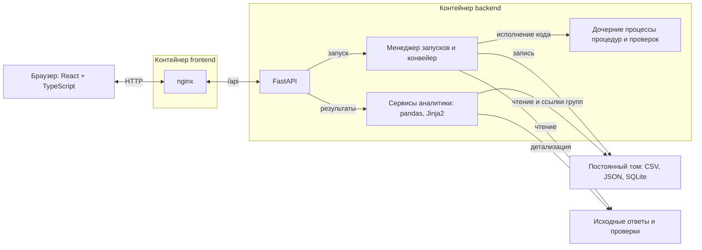

# Пояснительная записка

## 1. Реализованный подход

Система анализирует готовые ответы двух версий СПР на одинаковых заявках. Сравнение выполняется на уровне атрибутов, после чего результат агрегируется по заявкам, продуктам, моделям и типам изменений. Аналитик последовательно открывает сводную, список заявок и конкретное поле до/после.

Расчёт состоит из приведения ответов, сравнения, построения фактов и исполнения проверок. На основном наборе обработаны 4004 ответа для 2002 заявок.

## 2. Архитектура

Приложение развёртывается в двух контейнерах. nginx раздаёт интерфейс React и передаёт запросы `/api` в FastAPI. В бэкенде находятся менеджер запусков, конвейер обработки и сервисы аналитики. pandas выполняет табличные операции, Jinja2 формирует HTML-отчёт.

Python выбран для совместного использования pandas и проверок организаторов. Серверная агрегация позволяет передавать в браузер готовые группы вместо полной витрины. Файлы результатов сохраняют структуру расчёта и доступны для экспорта; SQLite хранит ссылки на группы заявок.

### Жизненный цикл

Создание запуска возвращает HTTP 202. Менеджер исполняет прогоны в пуле из двух потоков, этапы каждого прогона идут последовательно. Статусы и журнал сохраняются в JSON, интерфейс обновляет их опросом API. После расчёта выполняется прогрев кешей и устанавливается статус `ready`. Обновление страницы сохраняет текущий прогон; перезапуск сервера помечает незавершённый прогон прерванным.

## 3. Приведение и сравнение

### Сопоставление атрибутов

Нормализация разворачивает JSON в строки `APP_ID, SOURCE, PATH, ARRAY_KEY, VALUE, ADJUSTED_VALUE`. Путь описывает поле, `ARRAY_KEY` — элемент массива. Составной ключ сравнения: **`(APP_ID, PATH, ARRAY_KEY)`**.

| Режим массива | Способ сопоставления |
|---|---|
| `key` | По заданным полям элемента, включая составной ключ |
| `value` | По значению скалярного элемента |
| `index` | По позиции элемента |

Правила задаются процедурой и конфигурацией. Для неизвестных массивов используются значения уникальных скаляров или позиции элементов. Технические поля исключаются по `ignore_paths`. Неразобранные ответы отмечаются в журнале, односторонние заявки записываются в `unpaired.json` и исключаются из парного сравнения.

Встроенная процедура делает внешнее соединение двух срезов по ключу и сравнивает `VALUE`:

| Тип | Условие |
|---|---|
| `SAME` | Атрибут есть в обоих срезах, значения совпали |
| `VALUE_CHANGED` | Атрибут есть в обоих срезах, значения различаются |
| `ATTRIBUTE_NEW` | Атрибут есть только в AFTER |
| `ATTRIBUTE_LOST` | Атрибут есть только в BEFORE |

`DIFF_FLAG` равен 1 для всех типов, кроме SAME. JSON `null` сохраняется как значение и отличается от отсутствующего поля.

### Бакеты и витрины

Для настроенных числовых полей `ADJUSTED_VALUE` содержит диапазон. В остальных случаях он повторяет `VALUE`. Стандартное сравнение учитывает точное значение, поэтому изменение внутри одного бакета остаётся `VALUE_CHANGED`. Собственная процедура может сравнивать значения по диапазонам.

| Артефакт | Содержание и назначение |
|---|---|
| `comparison.csv` | Атрибуты с колонками до/после; основа сравнения и проверок |
| `union.csv` | Вертикальное объединение срезов с `SOURCE`; распределение значений и бакетов по срезам |
| `segments.csv` | Контекст заявки: решения, продукты, модель, порог и источник изменения |
| `apps.csv`, `summary.json` | Список заявок и общие показатели |
| `checks.csv` | Строки результатов всех подключённых проверок |

Основной набор дал 291 151 строку сравнения и 575 072 строки UNION. В слое разрезов продуктовые поля относятся к первому офферу по rank, а при отсутствии выдачи — к продукту с минимальным ID. Карточка отдельно показывает полный список продуктов.

Источник изменения определяется по входным префиксам `appData` и `ext_data`: различие входа даёт `data`, различия только в рассчитанных полях — `logic`, отсутствие различий — `none`. Общая сводка считает источники среди заявок со сменой решения.

## 4. Процедуры и проверки

Конфигурация выбирает процедуры этапов и набор проверок. Код можно написать в рабочем пространстве или подключить из серверных папок `procedures/` и `checks/`.

| Вид | Контракт |
|---|---|
| Приведение | `ARRAY_RULES`, настройки `BUCKETS` и `ID_PATH` |
| Факты | `FIELD_MAP` и `INPUT_PREFIXES` |
| Сравнение | `COMPARE["entrypoint"](before, after)` возвращает DataFrame |
| Проверка | `CHECK["entrypoint"](mart, params)` возвращает список строк |

Пользовательские процедуры приведения и фактов определяют правила для общего алгоритма. Процедура сравнения заменяет функцию сопоставления. Проверки получают MartAPI с методами `rows`, `count`, `app_ids`, `segments`, `total_apps`; параметры конфигурации перекрывают значения из `CHECK["params"]`.

Пользовательский код исполняется в дочерних процессах с проверкой контракта и таймаутами. Ошибки проверки записываются в журнал и диагностическую строку `FAIL / LOW`. Результаты остальных проверок сохраняются в общем отчёте. У запуска фиксируются конфигурация, настройки пользовательских процедур-данных и карта полей карточки.

## 5. Сводная и отчёт

Сервис `/facts` выбирает горизонтальную или вертикальную витрину, присоединяет разрезы заявки, применяет фильтры и группирует данные. Показатель `counts` считает строки, `counts_distinct_apps` — уникальные заявки. Ссылка `app_ids_ref` связывает группу со списком заявок, а выбранный путь атрибута передаётся в карточку.

Основной запрос сводной получает до 1000 групп; API поддерживает до 5000. Таблица показывает загруженные группы страницами и сообщает об усечённой выдаче. Горизонтальная база прогревается до готовности прогона, вертикальная загружается при первом обращении.

Карточка и причины читают исходные JSON. Для перехода одобрение → отказ причины группируются по отсечкам и стоп-факторам продуктов AFTER. Доли этого блока рассчитываются по строкам продуктов.

HTML-отчёт содержит сводку, все строки проверок и ссылки в приложение. Скачанный файл читается офлайн. Списки заявок выгружаются в CSV.

Дополнительное мнение ИИ выполняется отдельно после `ready`. Ollama Cloud получает счётчики, основные причины, строки FAIL и названия изменившихся атрибутов. Ответ сохраняется в `ai_review.json`.

## 6. Измерения и проверки

| Что замеряем | Минимум | Хорошо | Отлично | Наш результат |
|---|---|---|---|---|
| Приведение и сравнение всего датасета | ≤ 5 мин | ≤ 2 мин | ≤ 30 с | **28,42 с** |
| Открытие сводной таблицы | ≤ 5 с | ≤ 2 с | ≤ 0,5 с | **0,15 с** |
| Смена раскладки, фильтр, переход к заявке | ≤ 5 с | ≤ 1 с | ≤ 0,3 с | **0,10 / 0,10 / 0,14 с** |
| Повторное открытие готового отчёта | ≤ 5 с | ≤ 1 с | мгновенно | **0,12 с**, повторный вход на обзор |
| Прогресс долгого этапа и неблокирующий запуск | обязательно | — | — | **Реализованы:** прогресс, журнал, отмена |

Окружение: Windows 11, Python 3.14.7, pandas 3.1.1, 12 логических ядер, 31,6 ГБ памяти. Приведение и сравнение измерены прямым вызовом этапов с построением UNION. Время интерфейса — медиана трёх действий в Chromium по готовому прогону после прогрева, от действия до появления результата. Запуск выполнен вне Docker.

Корректность сверена с эталоном по восьми полям каждой заявки: признак различий, смена решения, решения до/после, модели PD до/после и названия порогов до/после. Для 2002 заявок OPEN и 998 HOLDOUT расхождений нет. Пять исходных проверок дали 34 строки; после подключения своей проверки получена 35-я строка с долей потери одобрения 13,6%.

[Результаты контрольной сверки](measurements/final-2026-11-07.json) · [Замеры интерфейса](measurements/interface-2026-11-08.json) · [Скриншоты](screenshots/README.md) · [Контракт API](api.md)
