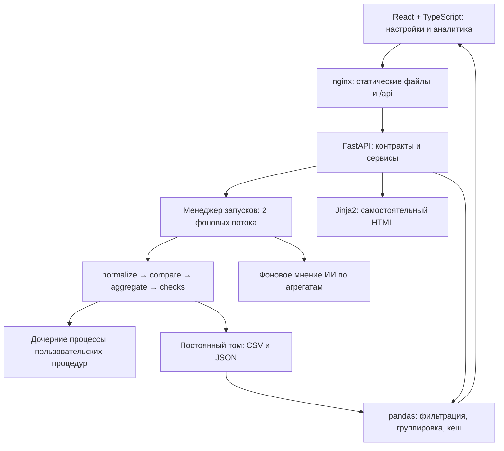

# Пояснительная записка: система анализа изменений «Различалка»

**Команда:** Сборная Чертановки. **Дата:** 7 ноября 2026 года.  
Описана реализация ветки `final`, исходный код `33ad03d`. Материалы сдачи подготовлены поверх этого среза.

Эта записка объясняет устройство и компромиссы решения. Команды развёртывания, состав команды и краткие результаты
находятся в [README](../README.md), последовательность демонстрации — в [сценарии](demo/README.md),
а подтверждающие экраны — в [галерее](screenshots/README.md).

## 1. Граница задачи и критерий полезности

Изменение стратегии СПР может затронуть решение, выбранный продукт, оценку риска, порог или сработавшие правила.
Сравнивать только итог APPROVE / REJECT недостаточно: изменение может быть существенным даже без смены решения.
С другой стороны, различие технического идентификатора запроса не означает изменения бизнес-результата.

На вход приложения поступают ответы на одни и те же исторические заявки в двух срезах. Приложение не вызывает СПР
и не принимает решения по новым клиентам. Его задача — сформировать воспроизводимый результат сравнения и дать
аналитику путь от общей картины до данных, которые образовали конкретное число.

У этого пути два режима: обзор показывает масштаб последствий, а детализация позволяет проверить отдельный сигнал.
Поэтому единицей сравнения служит атрибут, единицей списка — заявка, единицей результата проверки — возвращённая ею строка.
Эти количества не подменяют друг друга. Например, пять процедур на основном наборе дают 34 строки результата,
а одна заявка может участвовать сразу в нескольких группах атрибутов и продуктов.

## 2. Архитектура и выбор компонентов

Решение — приложение с разделёнными слоями в двух контейнерах. Внутри бэкенда расчёт отделён от HTTP-маршрутов,
а исполнение пользовательского кода вынесено в дочерние процессы.

| Решение | Причина выбора | Компромисс |
|---|---|---|
| Python + pandas | Проверки организаторов уже на Python; после приведения нужны соединения и группировки таблиц | Данные и промежуточные результаты занимают память; время зависит от объёма и типов колонок |
| FastAPI | Явный JSON-контракт, валидация запросов и документация API | Проверки бизнес-инвариантов всё равно пишутся в сервисах |
| React + TypeScript | Связанные экраны, фильтры, обновляемый статус и типы API | Типы клиента не заменяют серверную валидацию |
| Собственная сводная над серверными агрегатами | Сводная связана с фильтрами и проваливанием до заявок, полная витрина не передаётся в браузер | Раскладку, пагинацию и ограничения сочетаний полей реализуем сами |
| Файлы результатов и локальный кеш | Результат запуска формируется один раз, его удобно исследовать и переносить | Холодное чтение CSV дорого; нет общей транзакции по всем артефактам |
| Docker Compose | Фиксирует Linux-окружение, соединяет интерфейс и API, сохраняет результаты в томе | Нужен работающий движок контейнеров на машине эксперта |

Node.js или Django также могли бы обслуживать API. Python выбран не потому, что другие технологии не умеют
работать с таблицами, а чтобы не вводить ещё один исполнитель для Python-проверок и использовать готовые табличные операции.
Распределённая очередь и несколько микросервисов на этом этапе добавили бы инфраструктуру без подтверждённой нагрузочной необходимости.

## 3. Приведение, сопоставление и аналитические слои

### 3.1. Стабильная идентичность атрибута

Нормализация обходит ответ и создаёт строки по схеме `APP_ID, SOURCE, PATH, ARRAY_KEY, VALUE, ADJUSTED_VALUE`
с дополнительными полями разложенного пути. Для сравнения важен ключ **`(APP_ID, PATH, ARRAY_KEY)`**:
путь определяет поле, а ключ массива — продукт, модель или правило, к которому оно относится.

Сопоставление только по индексу массива создаёт ложные различия при перестановке или вставке элемента.
В режиме `key` элементы связываются по идентификатору; `value` подходит для наборов скаляров;
`index` сохраняется там, где позиция несёт смысл, например у вектора. Правила находятся в процедуре и могут
перекрываться настройками конфигурации. Для неизвестной структуры используются документированные умолчания с записью в журнал.

Технические поля исключаются по списку из манифеста / конфигурации. Идентификатор внутри ответа проверяется
на соответствие заявке, чтобы случайно не сравнить разные документы. Неразобранный ответ отмечается в журнале;
заявки без пары учитываются отдельно и исключаются из парного сравнения, а не превращаются в массовое удаление полей.

### 3.2. Значение и диапазон не равнозначны

`VALUE` хранит сравниваемое исходное значение, `ADJUSTED_VALUE` — его диапазон для аналитики.
Переход `0.42 → 0.48` внутри `(0.4 – 0.5]` остаётся изменением в стандартном режиме.
Бакеты одинаковы для обоих срезов: иначе распределения нельзя сопоставлять.

Встроенное сравнение делает внешнее соединение двух таблиц по ключу. Присутствие строки с обеих сторон и равенство
значений определяют SAME / VALUE_CHANGED; наличие только одной стороны — ATTRIBUTE_NEW / ATTRIBUTE_LOST.
JSON `null` отличается от отсутствующего атрибута. Результат проверяется по обязательным колонкам и словарю типов,
а `DIFF_FLAG` приводится в соответствие с `CHANGE_TYPE`.

Пример `example_compare_by_bucket.py` позволяет заменить правило и считать различия по диапазонам.
Это намеренное изменение семантики, а не скрытая оптимизация стандартного сравнения.

### 3.3. Зачем две витрины

**`comparison.csv`** — одна сопоставленная строка атрибута с колонками значений до/после.
Её ожидает MartAPI выданных проверок; она удобна для анализа конкретного перехода.

**`union.csv`** — строки обоих срезов вертикально, с `SOURCE` и значением одной стороны.
Он нужен для распределений «значение / бакет × срез». В фактическом конвейере после сравнения нормализованные
строки объединяются, затем получают признаки различия из `comparison.csv`. Отдельного SOURCE в ключе сопоставления нет:
задача сравнения — как раз связать разные срезы одного атрибута.

Для основного набора получены 291 151 строка сравнения и 575 072 строки UNION. Вертикальных строк не ровно вдвое
больше: у нового или исчезнувшего атрибута одна сторона отсутствует.

`segments.csv` добавляет контекст одной заявки: решения, продукты, модель, порог, партнёра и маршрутизацию.
Сервис `/facts` выбирает нужную витрину по измерениям запроса, присоединяет этот контекст, фильтрует и группирует.
`counts` считает строки, `counts_distinct_apps` — уникальные заявки. Суммирование пересекающихся групп не даёт
общее число заявок; интерфейс различает эти единицы.

### 3.4. Переход от агрегата к данным

Каждая группа получает `app_ids_ref`. В служебной SQLite сохраняется определение группы или список APP_IDS,
вернувшийся из проверки. По ссылке восстанавливаются заявки и применяется пагинация. Идентификатор ссылки нужен
для адресации группы, а не для аутентификации; доступ отдельно ограничивается владельцем запуска.

Из сводной передаются группа и путь атрибута, чтобы карточка открыла нужные поля. При обычном открытии карточки
первым показано объяснение, затем доступна таблица до/после. Большие таблицы сводной выводятся страницами:
не требуется создавать в DOM все строки и колонки одновременно.

Классификация `logic / data` проверяет различия входных префиксов, заданных процедурой (`appData`, `ext_data`
по умолчанию), после исключения технических полей. `characteristics` содержит уже обработанные СПР значения.
Такой подход показывает наблюдаемый источник различий, но не доказывает причинность при одновременной смене входа и стратегии.
Причины отказа по продуктам также не следует суммировать как независимые уникальные заявки.

## 4. Расширяемость, исполнение и отказоустойчивость

### Контракты процедур

Подключение кода — часть конфигурации запуска. Встроенную процедуру можно скопировать в рабочую область,
а собственную — написать inline или выбрать из разрешённой серверной папки `.py`.

| Вид | Контракт |
|---|---|
| Приведение | Код возвращает данные `ARRAY_RULES`, необязательные `BUCKETS`, `ID_PATH`; общий обход остаётся встроенным |
| Факты | `FIELD_MAP` и `INPUT_PREFIXES` определяют пути бизнес-полей и границу входных данных |
| Сравнение | `COMPARE["entrypoint"](before, after)` возвращает DataFrame согласованной схемы |
| Проверка | `CHECK["entrypoint"](mart, params)` возвращает строки результата |

Процедуры-данные исполняются в дочернем процессе; извлечённые настройки записываются в папку запуска.
Полностью свой алгоритм в текущем контракте поддерживается для сравнения, а не для произвольного обхода JSON.
У запуска есть снимок конфигурации и карты полей карточки, но полного версионирования всего пользовательского кода нет.

Проверки используют MartAPI (`rows`, `count`, `app_ids`, `segments`, `total_apps`). Индексы доступа строятся лениво,
чтобы повторные обращения не требовали наивного прохода по всей таблице. Все результаты собираются в один `checks.csv`.
Параметры конфигурации перекрывают `CHECK["params"]`. Ссылка ведёт к APP_IDS, реально возвращённым проверкой;
у пользовательского скрипта может быть собственное ограничение выборки.

### Граница изоляции

Для своего кода используются отдельный процесс, очищенное окружение, временная папка, статические запреты,
таймауты и Linux-лимиты ресурсов. Нормализация / факты как процедуры-данные ограничены 30 с, собственное сравнение —
300 с; загрузка проверки — 15 с, её выполнение — 60 с. Это ограничения соответствующих стадий, не гарантированное
общее время запуска и не полная защита каждого шага старта процесса.

Docker-бэкенд работает от обычного пользователя. Такая изоляция защищает основной процесс от типичных ошибок,
но не заменяет контейнерную / системную песочницу для заведомо недоверенного кода. Ошибка сравнения прерывает
прогон; ошибка одной проверки превращается в диагностическую строку и журнал, позволяя остальным проверкам выполниться.
CONFIDENCE=LOW отображается бледно, ошибка исполнения отделяется от бизнес-вердикта FAIL.

### Жизненный цикл

HTTP-запрос создания запуска возвращает 202, дальнейшая работа идёт в пуле из двух потоков.
Внутри одного прогона этапы последовательны; интерфейс получает статусы периодическим опросом.
Отчётные ручки закрыты до завершения обработки. В конце выполняется прогрев, затем выставляется `ready`;
ИИ запускается отдельно и этот статус не задерживает.

Конфигурации и состояние записываются атомарно через временный файл и замену. Обновление браузерной страницы
не прерывает расчёт. При перезапуске сервера незавершённые прогоны помечаются прерванными: возобновления с контрольной точки нет.
Состояние менеджера живёт в одном процессе; горизонтальное масштабирование требует общей очереди и хранилища состояния,
а не простого увеличения числа HTTP-процессов. `X-User` разделяет данные, но не является полноценной авторизацией.

## 5. Представление отчёта и второе мнение ИИ

HTML собирается Jinja2 из сохранённых результатов, содержит все строки проверок, срез, метрику, вердикт и ссылки.
Страница `/runs/{id}/report` загружает документ от имени выбранного пользователя; поэтому у него есть постоянный
маршрут приложения. Скачанный документ самодостаточен, его таблицы читаются офлайн. Ссылки на сводную и заявки
возвращают в работающее приложение и требуют доступа к соответствующему запуску.

ИИ получает не полную витрину, а ограниченную сводку: общие показатели, до пяти причин, до десяти строк FAIL
и до десяти наиболее изменившихся атрибутов. Полные ответы, APP_ID и значения атрибутов не передаются.
Ответ кешируется; сбой провайдера не меняет результаты расчёта. Без ключа показывается недоступность мнения.
Для демонстрации с готовым мнением нужно дождаться именно его, а не только `ready` основного прогона.
Часть проверок ответа модели касается процентов, но это не доказательство отсутствия других ошибок генерации.

## 6. Измерения и проверки

### Контрольный замер финального расчёта

Один прямой прогон реальных функций этапов `final` / `33ad03d`, основной датасет организаторов, стандартные
процедуры и пять проверок. Машина: Windows 11, сборка 26300, Intel64 Family 6 Model 186, 12 логических ядер,
31,6 ГБ памяти, Python 3.14.7, pandas 3.1.1. Время измерено `perf_counter`; нет HTTP, браузера и обращения к ИИ.

| Этап | Секунды |
|---|---:|
| Приведение обоих срезов | 14,09 |
| Сравнение и построение UNION | 14,33 |
| Разрезы и итоги | 2,72 |
| Пять проверок | 13,96 |
| Прогрев | 1,16 |
| **Сумма** | **46,26** |

Приведение + сравнение заняли **28,42 с** при планке ТЗ «отлично» ≤30 с. Это один замер на данном окружении,
не P95 и не гарантия для другой машины. Четыре этапа с проверками нельзя подменять этим частичным временем.

Вызов сервиса горизонтальной сводной после прогрева занял около 40 мс. Первый вызов вертикальной — 1450 мс,
повторный — 22 мс. Текущий прогрев загружает горизонтальную базу; UNION загружается лениво.
Эти числа не включают сеть и рендер браузера. Первый вертикальный запрос укладывается в «хорошо» ≤2 с
для сводной по времени сервиса, но не подтверждает браузерную планку «отлично» ≤0,5 с.

### Эксперименты и цена оптимизации

В раннем профиле основного отчёта значительную часть холодного запроса занимали чтение CSV (~0,22 с)
и преобразование типов (~0,29 с). Прогрев до `ready` перенёс эту работу с первого пользовательского действия
в завершение расчёта. В том эксперименте API сводной ускорился с 512 до 29 мс, атрибутов заявки — с 197 до 15 мс.

Это отдельное измерение Windows / Python 3.12.6 / 15,8 ГБ, сохранённое в [docs/perf.md](perf.md).
Его 10,4 с не включают проверки, прогрев и новый UNION. Старые оценки 12 / 21 с для Docker не используются
как гарантия скорости финальной версии: условия и состав операций отличаются.

Цена прогрева — время до готовности и память. Историческая оценка ~41 МБ получена `tracemalloc` для части кешей,
не является RSS всех процессов и не включает отдельную оценку нового вертикального слоя.
Кеши ограничены: крупные таблицы — LRU на четыре записи, заявки / разрезы — на шестнадцать;
горизонтальная и вертикальная базы имеют отдельные ключи. Вытеснение может вернуть холодную загрузку.

Эксперименты команды с семантикой: позиционное сравнение всех массивов увеличило VALUE_CHANGED с 7567 до 8217;
собственное сравнение по бакетам уменьшило его до 7450. Эти числа описывают разные правила, а не ускорение без изменения результата.

### Проверка корректности и интерфейса

Основной запуск подтверждает контрольные 502 заявки с различиями и 385 смен решения. Дополнительная сверка
с эталоном организаторов выполнена по восьми показателям каждой заявки в основном и отложенном наборах;
это не построчное равенство всей витрины. Проверки API / pipeline покрывают мини-данные, фильтры, владельцев,
четыре типа изменения, отчёт, отмену и контракты своих процедур.

Для [скриншотов](screenshots/README.md) отдельно выполнены реальные HTTP-прогоны финальной версии с production-сборкой
интерфейса: пять исходных проверок, затем добавление новой проверки и повторная обработка. Данные не подменялись
моками или заранее подготовленным статусом `ready`. Второй результат содержит 35 строк, включая новую проверку.
Скачанный HTML открыт локально, выполнен переход из него в сводную. Съёмка проведена в Chromium на Windows;
ключ ИИ не использовался, на экране честно показана его недоступность. Это не отдельная проверка Docker на чистой ОС.

## 7. Область применимости и развитие

Текущая реализация рассчитана на исследовательский сценарий с ограниченным числом запусков и доверенным кодом.
Не подтверждены нагрузка около 20 тысяч заявок, несколько тяжёлых прогонов одновременно и долговременная эксплуатация.
Код не версионируется полностью; нет автоматического продолжения после падения сервера и строгой аутентификации.
Постепенное получение ответов до конца внешнего прогона не реализовано и в финальном ТЗ обозначено необязательным улучшением.

При дальнейшем развитии сначала нужны измерения роста времени и памяти, затем устойчивая очередь, отдельные
исполнители и общая модель состояния. Для ускорения чтения можно рассмотреть Parquet / аналитический движок,
для безопасности — усиленную изоляцию и авторизацию. Прогрев вертикального слоя и параллельное приведение двух
срезов имеют понятные точки подключения, но их выигрыш нужно измерить вместе с дополнительной памятью.

## Источники реализации

- [Конвейер этапов](../backend/app/services/stages.py), [управление запусками](../backend/app/services/runs.py).
- [Приведение](../backend/pipeline/normalize.py), [сравнение](../backend/pipeline/compare.py), [UNION](../backend/pipeline/union.py).
- [Сервис фактов](../backend/app/services/facts.py), [прогрев](../backend/app/services/warmup.py).
- [Исполнение своих процедур](../backend/pipeline/user_procedures.py), [проверок](../backend/pipeline/checks_runner.py).
- [Договор API](api.md), [измерения](perf.md), [демонстрационная проверка](demo/step7_check.py).
