[README проекта](../../README.md) · [Пояснительная записка](../explanatory-note.md)  

## 1. Настройка и запуск

Выбор основного датасета показывает 2002 заявки и срезы MASTER → BETA.
Технические поля исключены из сравнения. Свои данные можно загрузить отдельно для каждой стороны.

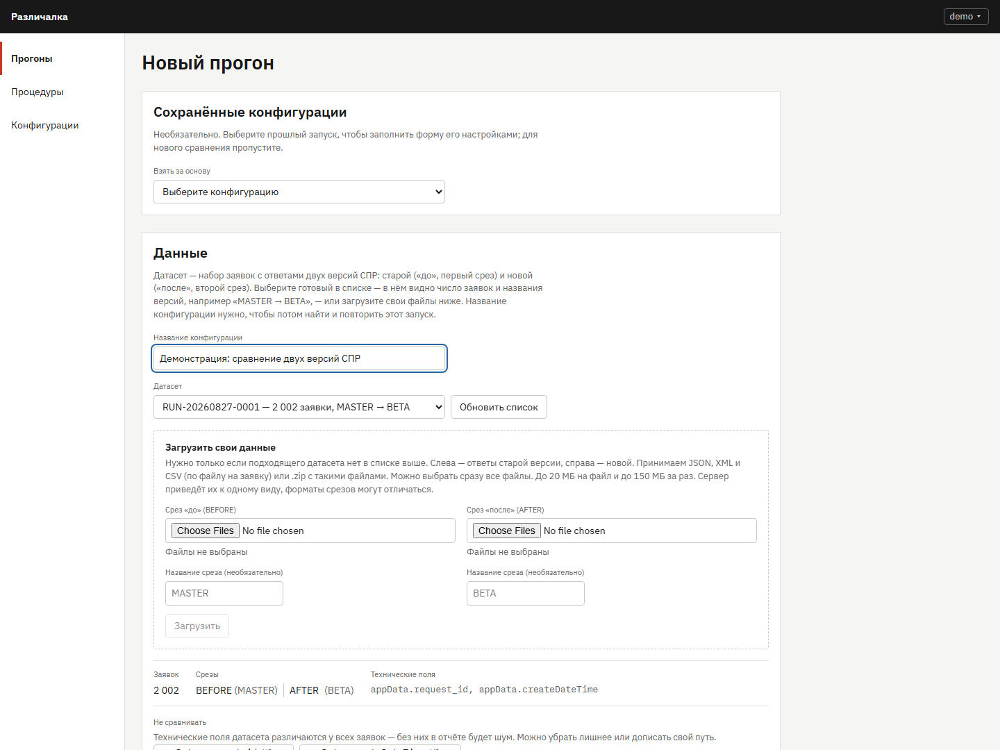

Ниже выбираются процедуры приведения, сравнения и фактов, а также пять исходных проверок.
Настройки сохраняются в конфигурации и используются при запуске.

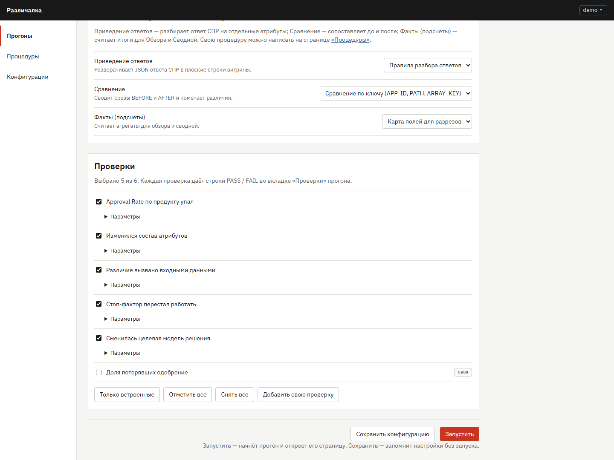

## 2. Журнал во время обработки

Запуск выполняется в фоне. На снимке обработка ещё идёт: видны текущий этап, прогресс и сообщения журнала.
Из этапа можно открыть код использованной процедуры.

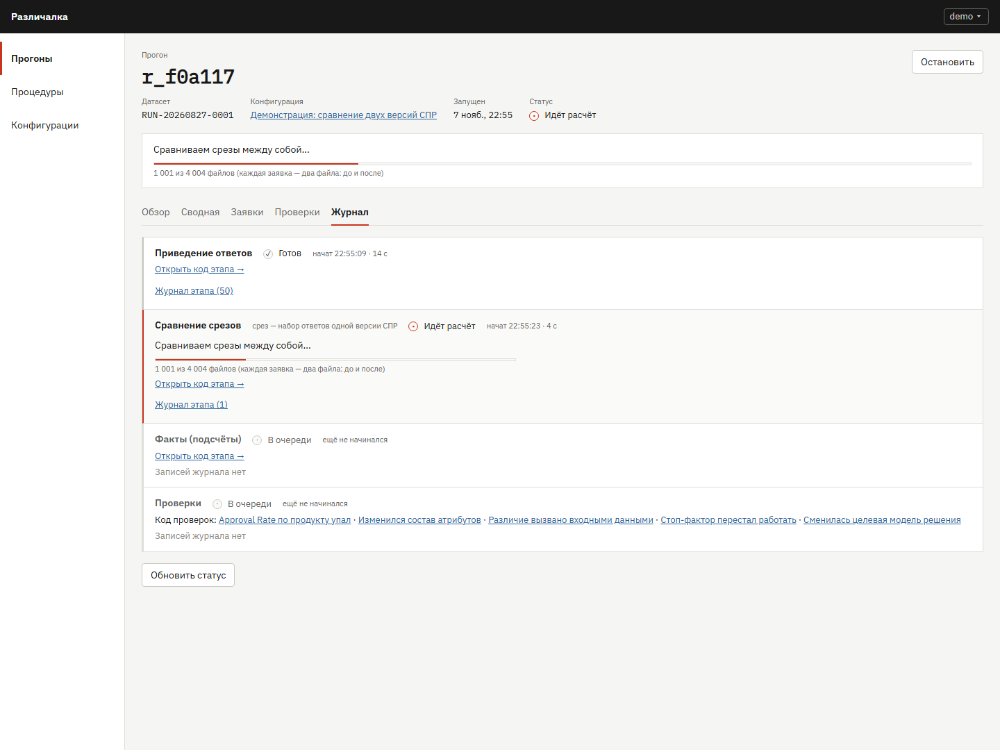

## 3. Итоги основного набора

**502** заявки имеют различия; у **385** сменилось решение: **273** одобрение → отказ и **112** отказ → одобрение.
Классификация источника смены решения: 218 «логика», 167 «данные».

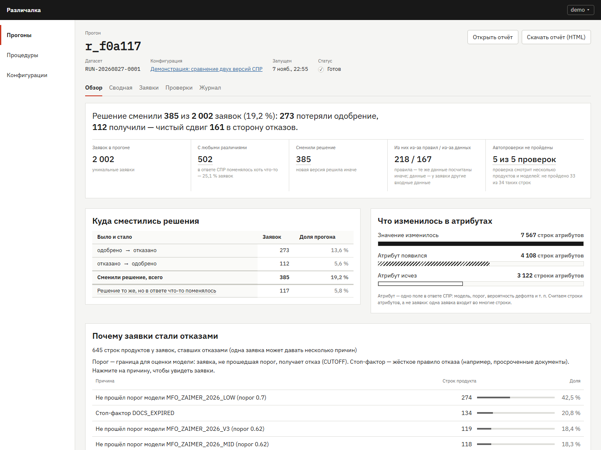

## 4. Сводная и переход к группе

Раскладка «путь × тип изменения» показывает уникальные заявки с различиями.

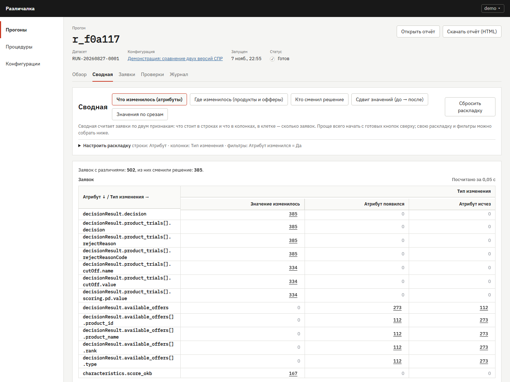

Нажатие на число открывает список заявок выбранной группы. Группа и путь атрибута передаются в детализацию.

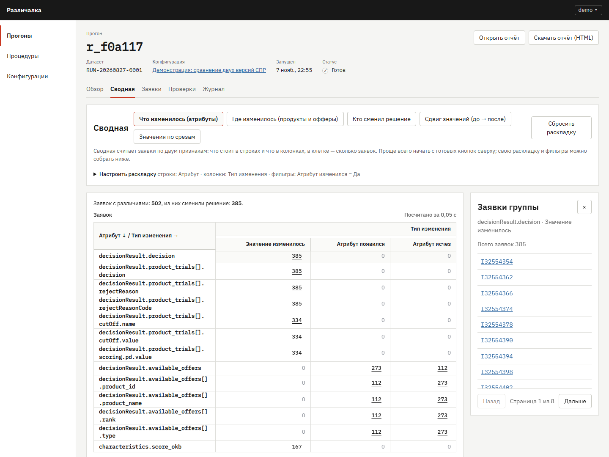

## 5. Заявка: атрибут и объяснение

Карточка открыта из сводной с фильтром `decisionResult.decision`: видны значения до и после.

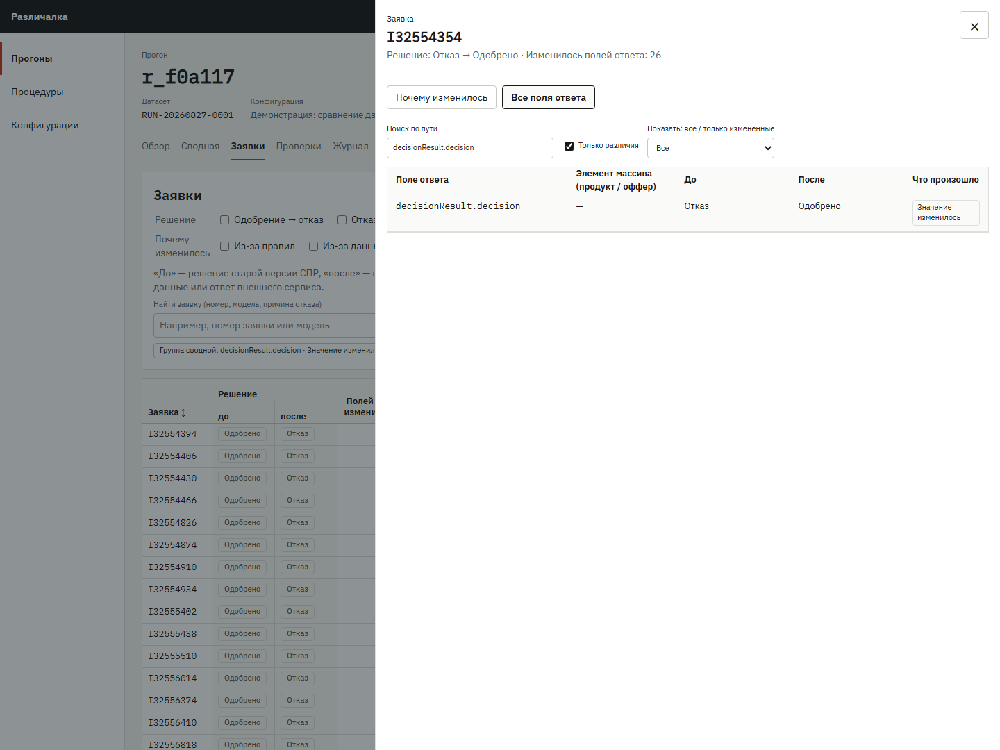

Вкладка объяснения связывает смену решения с продуктами, моделями, порогами и доступными причинами отказа.
Одна заявка может участвовать в нескольких продуктовых причинах.

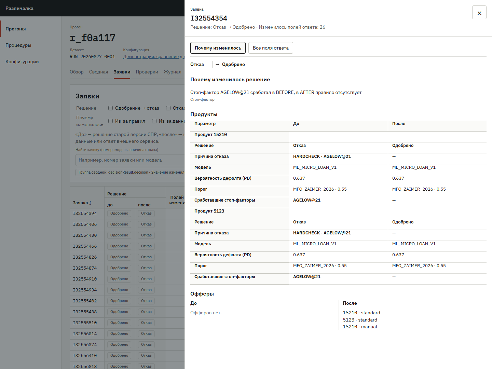

## 6. Пять выданных проверок

Получено **34 строки: 1 PASS и 33 FAIL**. 

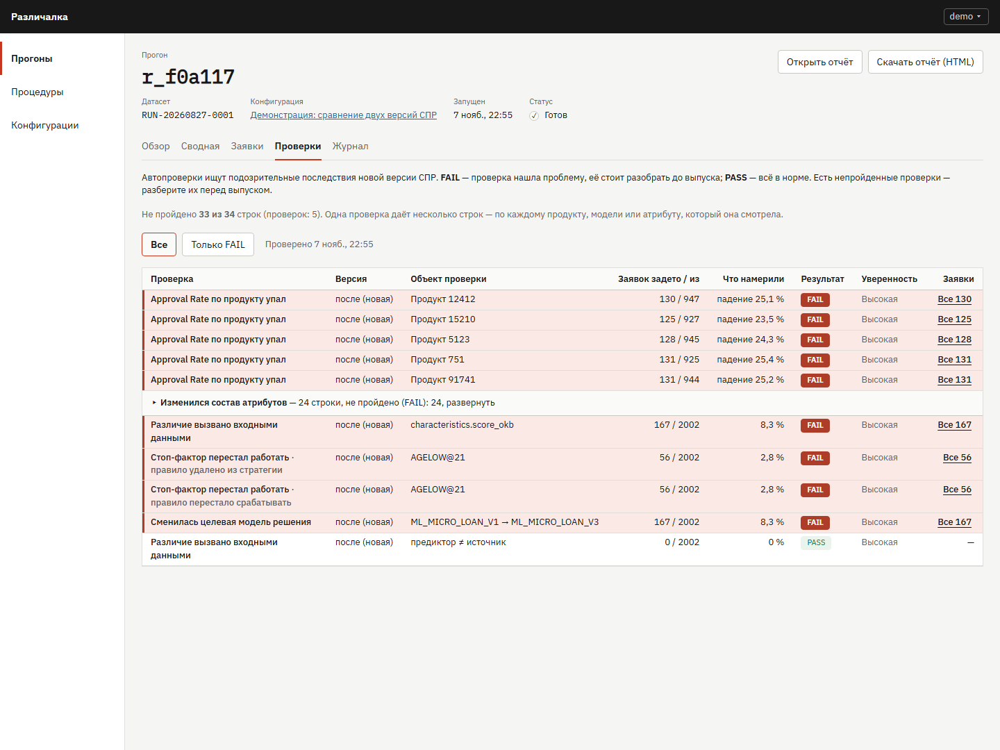

## 7. Новая проверка и её применение

В рабочем пространстве создана и проверена процедура из [step7_check.py](../demo/step7_check.py).
Она проверяет, превышает ли доля одобрение → отказ 10%. Полный исходный код доступен по ссылке;
в редакторе на снимке видна его часть.

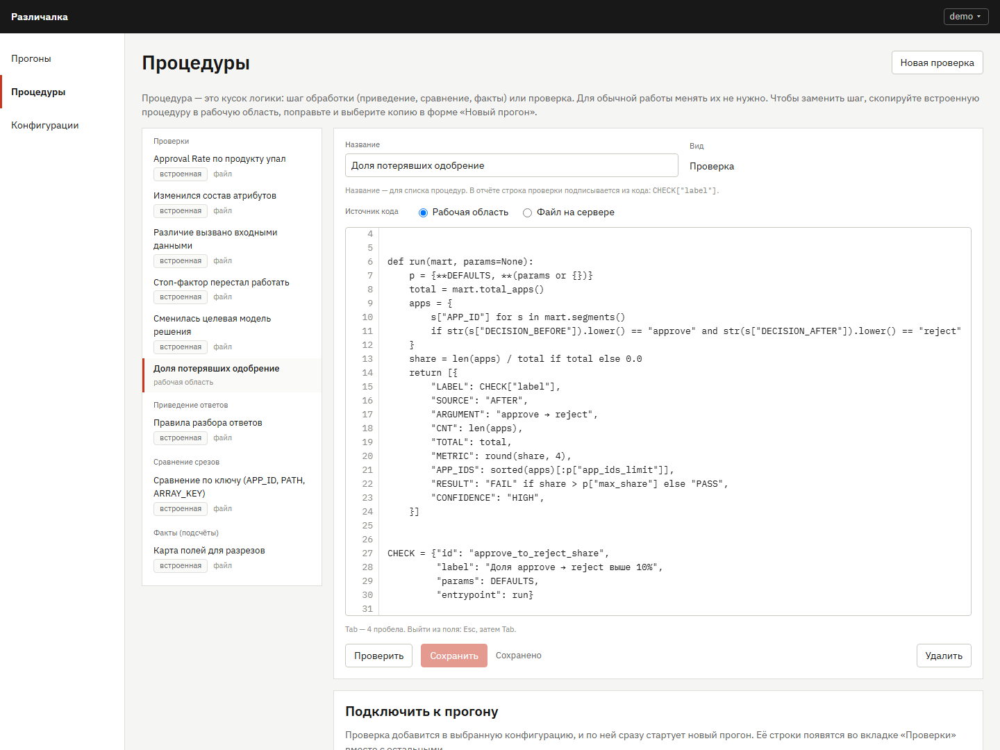

После подключения процедуры к конфигурации и нового прогона общий отчёт содержит **35 строк**.
Новая строка: **273 / 2002 = 13,6% → FAIL**. 

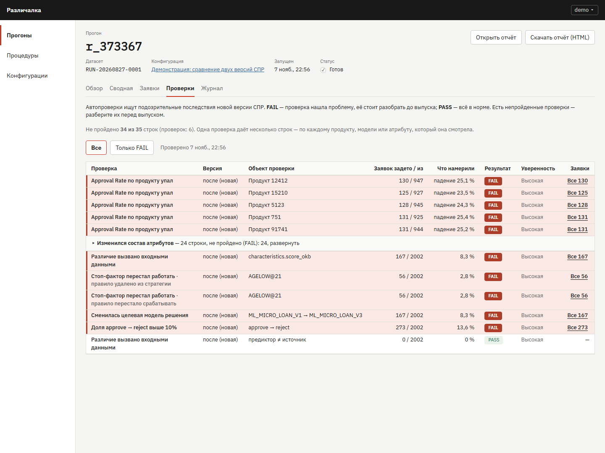

## 8. Самостоятельный HTML-отчёт

Отчёт сохранён через реальный endpoint экспорта и открыт локальным файлом.

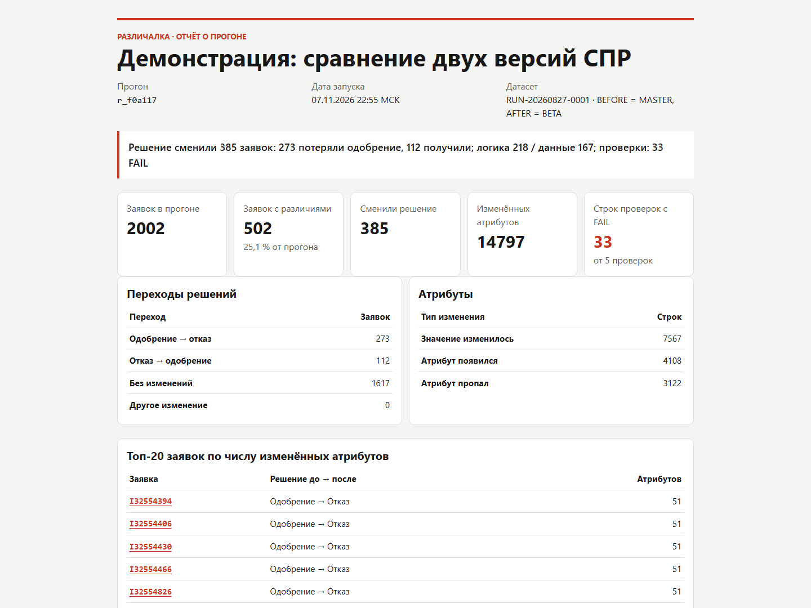

В конце документа находятся ссылки обратно в приложение. Таблица в HTML содержит все 34 строки исходных проверок.

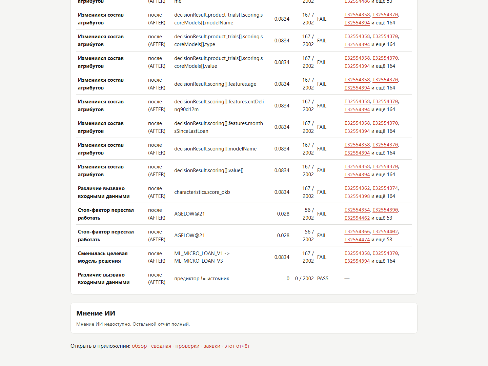

Архитектура, условия замеров и ограничения описаны в [пояснительной записке](../explanatory-note.md).
